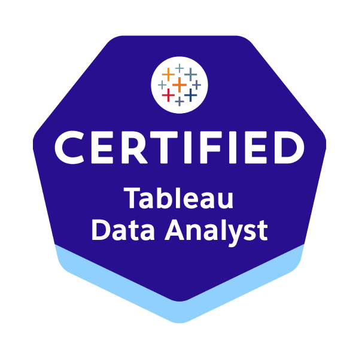

# Hi, I'm Dev 👋

**Data Analytics Consultant at The Information Lab** | **UCL Graduate**

I turn complex data into clear, actionable insights that help organizations make better decisions. My interests span data visualization, analytics engineering, and the relationships that make consulting meaningful.

## Skills & Tools

## About Me

I'm a Data Analytics Consultant at **The Information Lab**, with a degree in **Information Management for Business** from **University College London (UCL)**. My academic background gave me a foundation in relational data modeling, SQL, and object-oriented programming, alongside the business context needed to translate analysis into decisions.

Before moving into data consulting, I gained experience across technology, marketing, and research: developing front-end web experiences for a radio station, working at **L'Oréal**, representing **Deloitte** as a student ambassador, and leading market research for a Singapore-based maritime bunkering firm.

I believe data is only as valuable as the decisions it informs. What I enjoy most about consulting is building strong client relationships, understanding the goals behind the numbers, and creating solutions that people can actually use.

## Experience Highlights

- **The Information Lab — Data Analytics Consultant:** Helping turn business questions into actionable analysis and reporting.
- **L'Oréal — Digital & CRM:** Supported digital marketing, campaign execution, and customer engagement initiatives.
- **Maritime market research — Strategy & research:** Led research and stakeholder interviews to inform commercial decisions.
- **Deloitte — Student Ambassador:** Engaged with students and supported activities connecting business and technology.
- **Front-end web development:** Built and worked on web experiences for a radio station.

## Certifications

&nbsp;&nbsp;&nbsp;

**[Alteryx Designer Core](https://www.credly.com/badges/0d886f64-234b-40fd-a179-48b2efc34b96/public_url)** · **[Tableau Certified Data Analyst](https://trailhead.salesforce.com/en/credentials/certification-detail-print/?searchString=j+xIqd/T38mGYm923c2AxGFOw7qoiLqtxrSfqmnza+NSHY1s9nkJLntLTOD4tcgH)**

## What I'm Exploring

I'm continuing to develop my skills in **Power BI, Alteryx, Python, SQL, and data visualization**, with a particular focus on building robust data workflows and intuitive dashboards.

---

